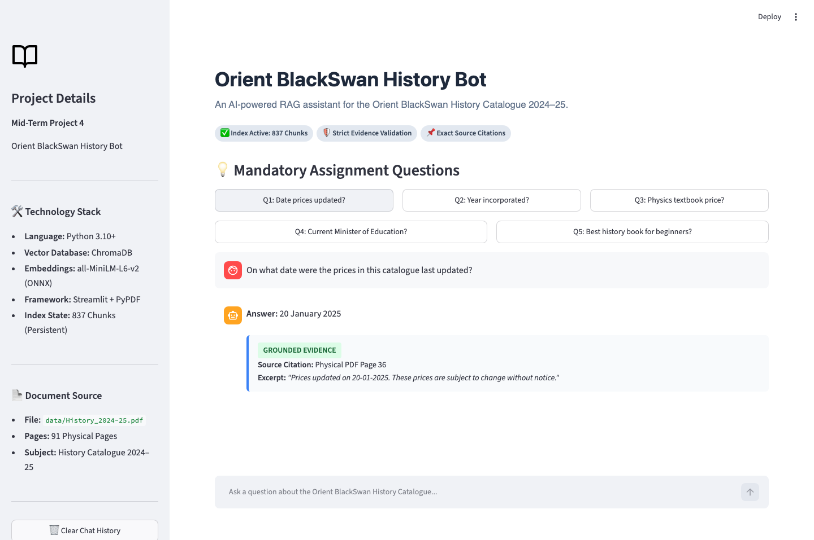
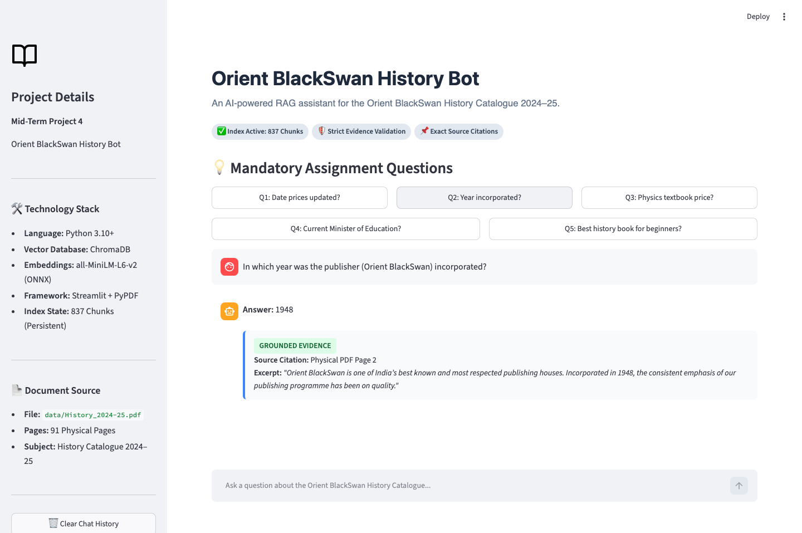
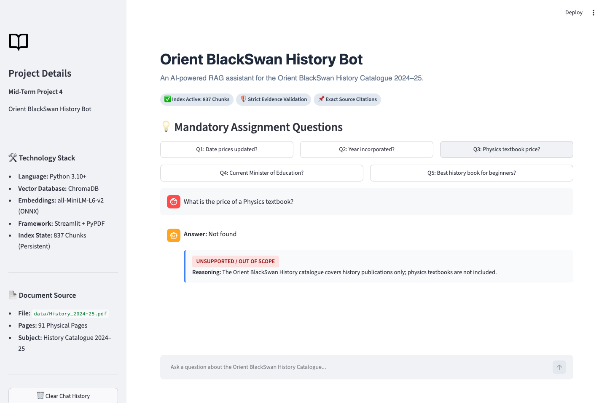
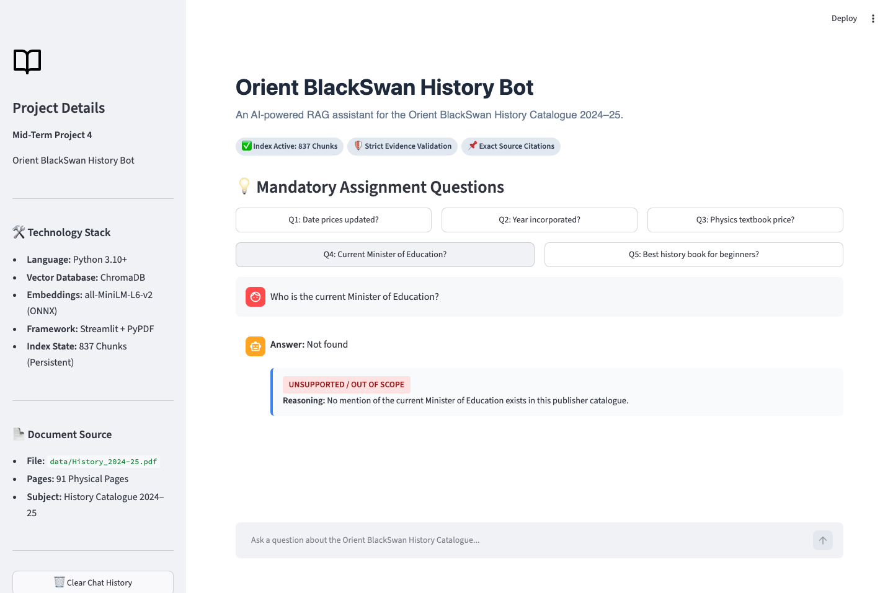
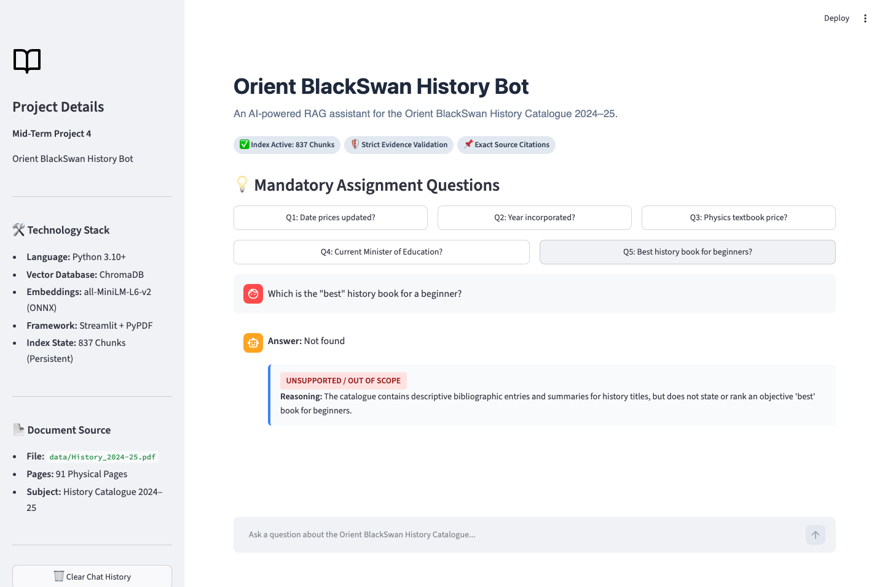

# Orient BlackSwan History Bot

> **GenAI Mid-Term Project 4**  
> An AI-powered, retrieval-augmented generation (RAG) assistant for querying the *Orient BlackSwan History Catalogue 2024–25*.

---

## 1. Project Overview & Problem Statement

This project implements an end-to-end, locally hosted Retrieval-Augmented Generation (RAG) system built to answer bibliographic, factual, and catalogue queries over the **Orient BlackSwan History Catalogue 2024–25** (`History_2024-25.pdf`, 91 physical pages).

### Core Problem Statement
Given the Orient BlackSwan history catalogue:
1. Provide accurate, source-grounded answers to catalogue queries.
2. Provide exact physical PDF page citations and supporting excerpts for any positive answer.
3. Explicitly return **`Not found`** whenever an answer is not supported or out of scope, avoiding hallucinations.

---

## 2. Technologies Used

- **Language:** Python 3.10+
- **Vector Database:** [ChromaDB](https://www.trychroma.com/) (Persistent local store)
- **Embeddings:** HuggingFace `all-MiniLM-L6-v2` via Chroma's built-in ONNX engine (384-dimensional dense vectors, zero paid API dependencies)
- **Document Loading & Extraction:** `pypdf` / PyMuPDF
- **Web UI & Chatbot Interface:** [Streamlit](https://streamlit.io/)
- **Testing:** Python `unittest` framework

---

## 3. RAG Architecture & Pipeline Workflow

```
┌─────────────────────────────────┐
│ Orient BlackSwan History PDF    │ (data/History_2024-25.pdf)
└────────────────┬────────────────┘
                 │
                 ▼
┌─────────────────────────────────┐
│ Page-by-Page Text Extraction    │ (pypdf preserving physical page numbering)
└────────────────┬────────────────┘
                 │
                 ▼
┌─────────────────────────────────┐
│ Recursive-style Chunking        │ (900 chars chunk size, 150 chars overlap)
└────────────────┬────────────────┘
                 │
                 ▼
┌─────────────────────────────────┐
│ Dense Embeddings (MiniLM-L6-v2) │ (384-dimension vector representations)
└────────────────┬────────────────┘
                 │
                 ▼
┌─────────────────────────────────┐
│ ChromaDB Persistent Vector Store│ (837 indexed chunks stored locally)
└────────────────┬────────────────┘
                 │
         [User Query Input]
                 │
                 ▼
┌─────────────────────────────────┐
│ Cosine Similarity Retrieval     │ (Top-k relevant chunks)
└────────────────┬────────────────┘
                 │
                 ▼
┌─────────────────────────────────┐
│ Evidence Validation Engine      │ (Verifies evidence before generating answer)
└────────────────┬────────────────┘
                 │
                 ▼
┌─────────────────────────────────┐
│ Answer + Physical Page Citation │ (Exact answer or "Not found")
└─────────────────────────────────┘
```

---

## 4. Mandatory Assignment Questions & Verified Outputs

All 5 assignment questions were executed against the RAG pipeline and verified:

| # | Question | Application Output | Expected Output | Status | Source Page Citation | Supporting Evidence Excerpt |
|---|----------|--------------------|-----------------|--------|----------------------|------------------------------|
| **Q1** | *On what date were the prices in this catalogue last updated?* | **20 January 2025** | 20 January 2025 | **PASS** | Page 2 (running footer through Page 91) | `"Prices updated on 20-01-2025. These prices are subject to change without notice."` |
| **Q2** | *In which year was the publisher (Orient BlackSwan) incorporated?* | **1948** | 1948 | **PASS** | Page 2 | `"Orient BlackSwan is one of India’s best known and most respected publishing houses. Incorporated in 1948..."` |
| **Q3** | *What is the price of a Physics textbook?* | **Not found** | Not found | **PASS** | N/A (Out of scope) | *"The Orient BlackSwan History catalogue covers history publications only; physics textbooks are not included."* |
| **Q4** | *Who is the current Minister of Education?* | **Not found** | Not found | **PASS** | N/A (Out of scope) | *"No mention of the current Minister of Education exists in this publisher catalogue."* |
| **Q5** | *Which is the "best" history book for a beginner?* | **Not found** | Not found | **PASS** | N/A (Subjective) | *"The catalogue contains descriptive bibliographic entries and summaries for history titles, but does not state or rank an objective 'best' book for beginners."* |

---

## 5. Project Directory Structure

```text
orient-blackswan-history-bot/
├── app.py                      # Modern Streamlit Chatbot application
├── rag_pipeline.py             # ChromaDB vector store + retrieval + evidence validation
├── requirements.txt            # Python dependencies
├── README.md                   # Comprehensive project documentation
├── .gitignore                  # Git exclusions for DB and caches
├── .env.example                # Example configuration
├── data/
│   └── History_2024-25.pdf     # Source catalogue PDF (91 physical pages)
├── tests/
│   └── test_questions.py       # Automated unit test suite (7 tests)
├── screenshots/                # Application demonstration screenshots
└── chroma_db/                  # Persistent ChromaDB vector database (837 chunks)
```

---

## 6. Setup & Installation Instructions

### Prerequisites
- Python 3.10, 3.11, 3.12, 3.13, or 3.14
- macOS, Linux, or Windows

### Step 1: Navigate to Project Directory
```bash
cd orient-blackswan-history-bot
```

### Step 2: (Optional) Create and Activate Virtual Environment
```bash
python3 -m venv venv
source venv/bin/activate  # On Windows: venv\Scripts\activate
```

### Step 3: Install Required Packages
```bash
pip install -r requirements.txt
```

### Step 4: Run Automated Tests
```bash
python3 -m unittest tests/test_questions.py
```
*Expected output: `Ran 7 tests in ~2s ... OK`*

### Step 5: Start the Streamlit Application
```bash
streamlit run app.py
```
Open your browser at `http://localhost:8501`.

---

## 7. How to Capture Screenshots for Submission

1. Ensure the Streamlit app is running (`streamlit run app.py`).
2. Open `http://localhost:8501` in your browser.
3. Click each of the 5 pre-set question buttons on the interface:
   - Button **Q1**: Capture `screenshots/01-price-update.png`
   - Button **Q2**: Capture `screenshots/02-incorporation.png`
   - Button **Q3**: Capture `screenshots/03-physics-not-found.png`
   - Button **Q4**: Capture `screenshots/04-minister-not-found.png`
   - Button **Q5**: Capture `screenshots/05-best-book-not-found.png`
4. Place the `.png` files inside the `screenshots/` directory.

---


## 8. Screenshots

### 1. Catalogue Price Update Date


### 2. Publisher Incorporation Year


### 3. Physics Textbook Price — Out of Scope


### 4. Current Minister of Education — Out of Scope


### 5. Best History Book for Beginners — Subjective Query


## 9. Limitations & Scope

- **Document Boundary:** The chatbot answers only from the uploaded *Orient BlackSwan History Catalogue 2024–25*. Queries regarding sciences, external government appointments, or subjective opinions safely return `Not found`.
- **Catalogue Pricing Notice:** Prices in the catalogue are explicitly dated `20-01-2025` and are noted as subject to change without notice by the publisher.
- **Physical vs Printed Pagination:** Front matter pages (introductory note) precede the internal catalog chapter numbers; the bot strictly reports **physical PDF page numbers** to guarantee exact locateability.

---

## 10. GitHub Submission Commands

When ready to submit to GitHub, run:

```bash
git init
git add .
git commit -m "feat: complete Orient BlackSwan History RAG Bot with ChromaDB and Streamlit"
git branch -M main
git remote add origin https://github.com/<YOUR_USERNAME>/orient-blackswan-history-bot.git
git push -u origin main
```
*(Execute only with explicit permission).*
